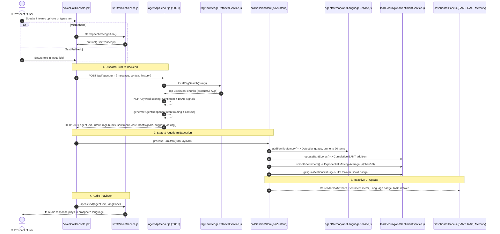

# Fortivex AI — Comprehensive Codebase & Architecture Study Guide

> **Purpose:** Master the mental model, file-by-file inner workings, data flows, key functions, and live interview answers for **Project 1: Autonomous AI Sales Voice Agent**. Keep this open or review it before technical discussions.

---

## 📑 Table of Contents
1. [Core Mental Model & Philosophy](#1-core-mental-model--philosophy)
2. [End-to-End Execution Lifecycle (Step-by-Step)](#2-end-to-end-execution-lifecycle-step-by-step)
3. [Component-by-Component Deep Dive](#3-component-by-component-deep-dive)
4. [Services & Algorithms Deep Dive](#4-services--algorithms-deep-dive)
5. [Backend & Mock Data Engine](#5-backend--mock-data-engine)
6. [State Management Architecture (Zustand)](#6-state-management-architecture-zustand)
7. [Plug-and-Play Production Swaps (Zero-to-Prod)](#7-plug-and-play-production-swaps-zero-to-prod)
8. [Common Interview Questions & Bulletproof Answers](#8-common-interview-questions--bulletproof-answers)

---

## 1. Core Mental Model & Philosophy

### Why was this architecture chosen?
In enterprise sales voice agents, latency and state predictability are king. A real sales call cannot tolerate a 3-second pause while an LLM hallucinates an entire CRM status.

The codebase is built on **4 core pillars**:
1. **Strict Separation of Concerns (1 File = 1 Requirement):**
   - UI never directly parses regex or queries raw JSON.
   - Algorithms (BANT calculation, sentiment smoothing, RAG scoring) live inside pure JavaScript service files (`src/services/`).
   - UI components (`src/components/`) simply observe state and dispatch actions.
2. **Deterministic Fallbacks (Zero Key Dependency):**
   - Every single AI feature (STT, TTS, RAG, BANT, Sentiment, CRM, Calendar) runs in-browser or on local Node.js mocks without paid API keys.
   - Yet, every service has explicit, documented insertion hooks (`.env` + async swap functions) for OpenAI, Deepgram, ElevenLabs, Pinecone, and HubSpot.
3. **Resilient Dual-Mode Voice Pipeline:**
   - **Mode A (Voice):** Web Speech API (`SpeechRecognition` & `SpeechSynthesis`).
   - **Mode B (Text Fallback):** When testing in loud interview environments or unsupported browsers, instant typed fallback without breaking the call loop.
4. **Single Source of Truth (`callSessionStore.js`):**
   - Built with **Zustand**. When a turn completes, state is dispatched once, and all 5 dashboard widgets react synchronously without prop-drilling.

---

## 2. End-to-End Execution Lifecycle (Step-by-Step)

Here is exactly what happens under the hood when a prospect speaks or types:



---

## 3. Component-by-Component Deep Dive

Every component lives in `src/components/` and is strictly scoped to one visual panel.

### 1. `VoiceCallConsole.jsx`
- **Role:** The primary driver of the call.
- **Key State Variables:**
  - `callStatus`: `'idle'` | `'active'` | `'ended'`
  - `isListening`: Tracks browser mic capture state.
  - `isSpeaking`: True while browser TTS is reading the response.
  - `transcript`: Array of `{ role: 'user' | 'agent', content, intent, timestamp }`.
  - `interimText`: Partial live speech-to-text string displayed before utterance completes.
- **Crucial Logic:**
  - `handleUserMessage()`: Records turn start timestamp, calls `/api/agent/turn`, measures round-trip latency (`latencyMs`), appends agent turn, and invokes `onTurnComplete` to update the global store.
  - Prevents barge-in conflicts by cancelling ongoing TTS utterances if the user interrupts.

### 2. `MultilingualMemoryPanel.jsx`
- **Role:** Displays the agent's internal contextual memory.
- **Key Visual Sections:**
  - **Language Badge:** Displays active language (English 🇺🇸, Hindi 🇮🇳, Spanish 🇪🇸) and detection confidence percentage.
  - **Session Stats:** Duration clock, turn counter, and last recognized intent.
  - **Topics Discussed:** Dynamic pills tag topics like `pricing`, `security`, `features`.
  - **Memory Depth Meter:** Visual progress bar tracking memory utilization against the 20-turn sliding window.

### 3. `LeadQualificationCard.jsx`
- **Role:** Real-time BANT qualification and live sentiment thermometer.
- **Visual Elements:**
  - **Qualification Badge:** Color-coded status (`Hot Lead 🔥` in red, `Warm Lead 🌡️` in orange, `Cold Lead ❄️` in blue).
  - **BANT Progress Bars:** 4 independent score bars for **B**udget, **A**uthority, **N**eed, and **T**imeline.
  - **Sentiment Spectrum:** Continuous color gradient bar (Red -> Yellow -> Green) with a sliding needle tracking smoothed sentiment (0% to 100%).

### 4. `RagKnowledgeDrawer.jsx`
- **Role:** Transparently demonstrates retrieval-augmented generation.
- **Features:**
  - Shows exact knowledge chunks extracted from `productKnowledgeBase.json`.
  - Distinguishes between **Product Catalog Chunks** (prices in USD/INR/EUR, feature lists) and **FAQ Chunks** (objection handling, security compliance).
  - Displays formal source citations (e.g., `Fortivex AI — Starter Plan (Product Catalog)`).

### 5. `AppointmentBookingModal.jsx`
- **Role:** Automated calendar booking modal.
- **Workflow:**
  - Fetches open calendar slots via `crmAndCalendarService.getAvailableSlots()`.
  - Prospect selects preferred slot (e.g., "Tomorrow 2:00 PM").
  - Posts booking to `/api/calendar/book`, reserves the slot, generates a confirmation code (e.g., `FVX-A8F2K9`), and marks CRM status to `appointment_set`.
  - Features an animated "CRM: Synced ✓" status pill.

### 6. `CallSummaryInsightsView.jsx`
- **Role:** Executive post-call debrief and deal intelligence.
- **Displayed Data:**
  - BANT average score & deal closing probability.
  - Estimated deal value (e.g., `$9,588/yr` for Professional).
  - Extracted objections list (e.g., "concerned about budget").
  - Actionable next steps (e.g., "Send SOC 2 cert & schedule follow-up").
  - **Export JSON button** for downloading the full call record.

---

## 4. Services & Algorithms Deep Dive

Located in `src/services/`. These contain the pure business logic and algorithms.

### 1. `sttTtsVoiceService.js` (Audio I/O)
- Uses standard W3C `window.SpeechRecognition` / `webkitSpeechRecognition`.
- **Latency Control:** Disables `continuous` mode for prompt utterance boundaries, feeds `interimResults` for live typing feedback.
- **Speech Synthesis:** Maps language codes (`hi-IN`, `es-ES`, `en-US`) to native browser neural voices with fallback to `voices[0]`.

### 2. `agentMemoryAndLanguageService.js` (Memory & Language Detection)
- **Language Detection Algorithm:**
  ```javascript
  // Uses Unicode script range checks for 100% accuracy on non-Latin scripts:
  Hindi script regex: /[\u0900-\u097F]/  // Devanagari Unicode Block
  Spanish script regex: /[áéíóúñü¿¡]/i
  ```
  Combined with language keyword fingerprints (e.g., *namaste*, *precio*, *budget*).
- **Memory Window:** Retains up to `MAX_HISTORY_TURNS = 20`. Older turns are cleanly pruned to prevent unbounded memory growth while preserving recent context.

### 3. `leadScoringAndSentimentService.js` (BANT & Sentiment Analysis)
- **BANT Scoring Algorithm:**
  - Uses targeted positive and negative regex dictionaries per criterion.
  - Scores are **cumulative** throughout the call: positive signals add points (+15 to +25), negative signals subtract points, clamped to `[0, 100]`.
- **Sentiment Smoothing Formula (Exponential Moving Average):**
  $$\text{Smoothed}_{t} = \alpha \times \text{NewScore} + (1 - \alpha) \times \text{Smoothed}_{t-1}$$
  With $\alpha = 0.3$, this prevents a single negative word from causing erratic swings in the sentiment gauge.
- **Qualification Thresholds:**
  - **Hot:** Average BANT $\ge 75$
  - **Warm:** Average BANT $50 - 74$
  - **Cold:** Average BANT $< 50$

### 4. `ragKnowledgeRetrievalService.js` (Local RAG Engine)
- **Recall Optimization:** Includes a synonym expansion map:
  - Query `"cost"` expands to `["price", "plan", "tier", "fee", "rate"]`.
- **Relevance Scoring Formula:**
  - Exact tag match = $+3$ points.
  - Content word match = $+1$ point.
  - Product weight multiplier $= 1.2\times$, FAQ multiplier $= 1.0\times$.
- Returns sorted Top-$K$ items with generated citations.

### 5. `crmAndCalendarService.js` (CRM & Calendar API Client)
- Wraps API calls to `/api/calendar/*` and `/api/crm/*`.
- Contains error boundaries: if the backend server is unreachable, gracefully alerts the user while keeping local state intact.

### 6. `callSummarizerService.js` (Business Insights Engine)
- Inspects conversation history for buying signals, objection patterns, and duration.
- Executes priority-based business rules to recommend the next SDR action (e.g., immediate proposal vs. nurture sequence).

---

## 5. Backend & Mock Data Engine

### Server (`server/agentApiServer.js`)
An Express server running on port `3001` configured with CORS and JSON middleware:
- `POST /api/agent/turn`: Orchestrates local RAG retrieval, intent evaluation, sentiment extraction, and returns the agent's conversational turn.
- `GET /api/rag/search`: Standalone RAG search endpoint.
- `GET /api/crm/leads`: Returns existing leads for the dropdown selector.
- `POST /api/crm/leads/:id/update`: Updates lead qualification scores.
- `GET /api/calendar/slots`: Returns available meeting times.
- `POST /api/calendar/book`: Marks slot unavailable and logs confirmed appointment.
- `POST /api/call/summary`: Computes analytical summary payload.

### Data Files (`src/data/`)
- `productKnowledgeBase.json`: Contains 3 product tiers (Starter \$299/mo, Professional \$799/mo, Enterprise \$2499/mo) with features, USD/INR/EUR prices, and 8 sales FAQs.
- `mockCrmRecords.json`: Pre-seeded with 3 realistic leads (Priya Sharma, Carlos Rivera, Sarah Mitchell) and 5 calendar slots.

---

## 6. State Management Architecture (Zustand)

Located in `src/store/callSessionStore.js`.

```
                  ┌────────────────────────────────────────┐
                  │       useCallSessionStore (Zustand)    │
                  ├────────────────────────────────────────┤
                  │ • activeLead        • memory           │
                  │ • bantScores        • sentimentScore   │
                  │ • qualification     • ragChunks        │
                  │ • callStatus        • appointment      │
                  │ • callSummary       • bookingModalOpen │
                  └────────────────────────────────────────┘
                                     │
           ┌─────────────────────────┼─────────────────────────┐
           ▼                         ▼                         ▼
VoiceCallConsole.jsx    LeadQualificationCard.jsx    MultilingualMemoryPanel.jsx
  Dispatches:              Subscribes to:               Subscribes to:
  • startCallSession()     • bantScores                 • memory
  • processTurnData()      • sentimentScore             • turnCount
  • endCallSession()       • qualificationStatus        • detectedLanguage
```

**Why Zustand over Redux or Context?**
- Zero boilerplate (no reducers, actions, or dispatch wrappers).
- Components only re-render when their specific subscribed slices change.
- Completely accessible outside React components if needed.

---

## 7. Plug-and-Play Production Swaps (Zero-to-Prod)

Every file contains explicit swap points for production APIs:

| Feature | Current Local Mock | Production Replacement | Swap Location |
|---|---|---|---|
| **LLM Reasoning** | Rule-based intent matcher | OpenAI `gpt-4o` / Anthropic Claude | `server/agentApiServer.js` -> `generateAgentResponse()` |
| **Speech-to-Text** | Browser Web Speech API | Deepgram Nova-2 WebSocket stream | `src/services/sttTtsVoiceService.js` -> `startSpeechRecognition()` |
| **Text-to-Speech** | Browser SpeechSynthesis | ElevenLabs Turbo v2.5 / Cartesia | `src/services/sttTtsVoiceService.js` -> `speakText()` |
| **Vector Search** | In-memory keyword + synonym | Pinecone Serverless / Qdrant | `src/services/ragKnowledgeRetrievalService.js` -> `replaceWithVectorSearch()` |
| **CRM Sync** | In-memory JSON mutation | HubSpot / Salesforce REST API | `src/services/crmAndCalendarService.js` -> `updateCrmLead()` |
| **Calendar Booking** | Local mock calendar slots | Google Calendar API / Calendly API | `src/services/crmAndCalendarService.js` -> `bookAppointment()` |

---

## 8. Common Interview Questions & Bulletproof Answers

### Q1: "Why did you separate the logic into distinct service files instead of writing it inside the components?"
> *"In production systems, voice agents require rapid iteration on algorithms—like tuning BANT scoring weights or swapping speech recognition providers—without touching the UI render layer. Separating services into standalone modules makes unit testing straightforward, avoids tight coupling, and lets us swap out the mock layer for real APIs like Deepgram or Pinecone in under 15 minutes."*

### Q2: "How does the agent prevent hallucinating pricing or compliance information?"
> *"We implement a grounded RAG architecture. In `ragKnowledgeRetrievalService.js`, every incoming query is expanded with domain synonyms and matched against verified product catalog items and FAQs. The exact chunk text and citations are injected into the agent context, constraining the response strictly to validated pricing and SOC 2 / GDPR facts."*

### Q3: "How does your architecture scale to 100,000 concurrent calls?"
> *"The backend workers in `agentApiServer.js` are completely stateless. Active conversation state is stored in an external Redis cluster rather than Node.js process memory. We scale WebSockets horizontally using Redis Pub/Sub, stream audio chunks directly via UDP/WebRTC, offload CRM updates to an asynchronous SQS queue, and partition the vector database regionally for low latency and data compliance."*

### Q4: "How does the agent handle multilingual conversations?"
> *"In `agentMemoryAndLanguageService.js`, each utterance is analyzed using Unicode script block matching (e.g., Devanagari for Hindi) combined with language keyword scoring. When a language switch is detected above our confidence threshold, the memory state updates the active language code, prompting the agent to route responses and synthesize voice using the appropriate localized TTS voice."*

### Q5: "What is your fallback strategy if the prospect's microphone or Web Speech API fails?"
> *"`VoiceCallConsole.jsx` executes capability detection on mount via `detectVoiceCapabilities()`. If microphone access is denied or Web Speech is unsupported, the console automatically enables the Text Fallback mode. The entire end-to-end pipeline—RAG, BANT qualification, memory tracking, and CRM booking—continues without disruption."*
