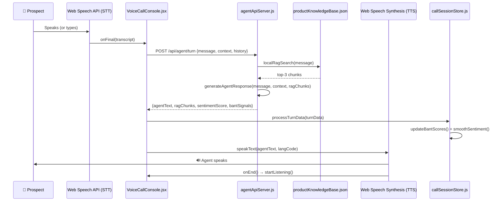
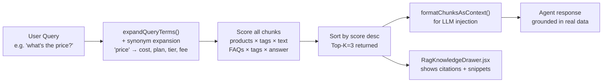
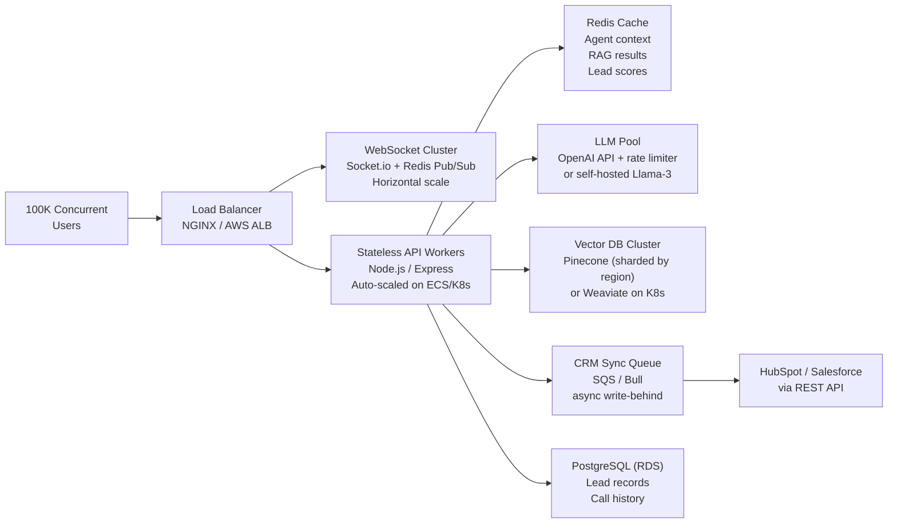

# System Architecture Diagram — Fortivex AI Voice Agent

> **Project 1:** Autonomous AI Sales Voice Agent MVP  
> Architecture covers: real-time audio flow, RAG pipeline, state store, and external integrations.

---

## High-Level Architecture

```mermaid
flowchart TD
    subgraph BROWSER["🌐 Browser (React + Vite, port 5173)"]
        UI["App.jsx\n(Dashboard Orchestrator)"]
        STORE["callSessionStore.js\n(Zustand Global State)"]

        subgraph COMPONENTS["UI Components"]
            VCC["VoiceCallConsole.jsx\n🎙️ STT / TTS / Transcript"]
            MMP["MultilingualMemoryPanel.jsx\n🧠 Memory + Language"]
            LQC["LeadQualificationCard.jsx\n🏆 BANT + Sentiment"]
            RKD["RagKnowledgeDrawer.jsx\n📚 RAG Chunks"]
            ABM["AppointmentBookingModal.jsx\n📅 Calendar + CRM Sync"]
            CSV["CallSummaryInsightsView.jsx\n📊 Post-Call Report"]
        end

        subgraph SERVICES["Frontend Services"]
            STV["sttTtsVoiceService.js\n(Web Speech API)"]
            AML["agentMemoryAndLanguageService.js\n(NLP + Memory)"]
            LSS["leadScoringAndSentimentService.js\n(BANT + Sentiment)"]
            RKR["ragKnowledgeRetrievalService.js\n(Local RAG)"]
            CCS["crmAndCalendarService.js\n(API Client)"]
            CSR["callSummarizerService.js\n(Summary Gen)"]
        end
    end

    subgraph SERVER["🖥️ Node.js Express Server (port 3001)"]
        API["agentApiServer.js"]
        EP1["/api/agent/turn"]
        EP2["/api/rag/search"]
        EP3["/api/crm/leads"]
        EP4["/api/calendar/slots"]
        EP5["/api/calendar/book"]
        EP6["/api/call/summary"]
        API --> EP1 & EP2 & EP3 & EP4 & EP5 & EP6
    end

    subgraph DATA["💾 Local Data Layer"]
        KB["productKnowledgeBase.json\n3 products · 8 FAQs"]
        CRM["mockCrmRecords.json\n3 leads · 5 calendar slots"]
    end

    subgraph EXTERNAL["☁️ External APIs (optional — activate via .env)"]
        OAI["OpenAI GPT-4o\n(Real LLM responses)"]
        DG["Deepgram Nova-2\n(Real STT)"]
        EL["ElevenLabs\n(Custom TTS voice)"]
        HS["HubSpot / Salesforce\n(Real CRM)"]
        GC["Google Calendar\n(Real slots)"]
        PC["Pinecone\n(Vector DB for RAG)"]
    end

    %% User voice flow
    USER(["👤 Prospect"]) -->|"Speaks / Types"| VCC
    VCC -->|"Uses"| STV
    STV -->|"Web Speech API STT"| VCC
    VCC -->|"POST /api/agent/turn"| EP1
    EP1 -->|"Keyword RAG"| KB
    EP1 -->|"Mock LLM response"| VCC
    VCC -->|"TTS playback"| STV

    %% State updates
    VCC -->|"processTurnData()"| STORE
    STORE -->|"updateBantScores()"| LSS
    STORE -->|"addTurnToMemory()"| AML
    STORE -->|"ragChunks"| RKD

    %% Component reads from store
    STORE --> MMP & LQC & RKD & CSV

    %% Booking flow
    ABM -->|"GET /api/calendar/slots"| EP4
    ABM -->|"POST /api/calendar/book"| EP5
    EP5 --> CRM

    %% CRM sync
    CCS -->|"POST /api/crm/leads/:id/update"| EP3
    EP3 --> CRM

    %% Summary flow
    CSV -->|"POST /api/call/summary"| EP6
    CSR --> CSV

    %% External swaps (dashed)
    EP1 -.->|"swap mock→real"| OAI
    STV -.->|"swap Web Speech"| DG
    STV -.->|"swap Web Speech"| EL
    CCS -.->|"swap mock CRM"| HS
    CCS -.->|"swap mock calendar"| GC
    RKR -.->|"swap keyword RAG"| PC

    UI --> STORE
    UI --> COMPONENTS
    COMPONENTS --> SERVICES
```

---

## Component Responsibility Map

| Component / File | Owns | Reads from | Writes to |
|---|---|---|---|
| `VoiceCallConsole.jsx` | Audio I/O, transcript UI, turn orchestration | `sttTtsVoiceService`, memory prop | `callSessionStore` via `onTurnComplete` |
| `MultilingualMemoryPanel.jsx` | Language + memory display | `callSessionStore.memory` | — (read-only) |
| `LeadQualificationCard.jsx` | BANT bars, sentiment meter, qualification badge | `callSessionStore.bantScores`, `sentimentScore` | — (read-only) |
| `RagKnowledgeDrawer.jsx` | RAG chunk display, citations | `callSessionStore.ragChunks` | — (read-only) |
| `AppointmentBookingModal.jsx` | Slot picker, booking form, CRM sync indicator | `crmAndCalendarService.getAvailableSlots()` | `crmAndCalendarService.bookAppointment()` |
| `CallSummaryInsightsView.jsx` | Post-call report, insights, export | `callSessionStore.callSummary` | — (read-only) |
| `agentApiServer.js` | REST API, mock LLM, local RAG, in-memory CRM | `productKnowledgeBase.json`, `mockCrmRecords.json` | `mockCrmRecords.json` (in-memory) |
| `callSessionStore.js` | Global reactive state | All services | All components via Zustand subscriptions |

---

## Real-Time Audio Flow (STT → LLM → TTS)

**Typical latency (mock mode):** 50–200ms · **Live mode (OpenAI):** 350–600ms

---

## RAG Pipeline Detail

**Production upgrade path:** Replace `localRagSearch()` → Pinecone/Weaviate with `text-embedding-3-small` embeddings. Swap point clearly marked in `ragKnowledgeRetrievalService.js > replaceWithVectorSearch()`.

---

## Scalability Architecture (100,000 Concurrent Users)

**Key scaling strategies:**
- Stateless workers: session state in Redis (not in-process memory)
- WebSocket rooms for per-call pub/sub (agent ↔ frontend streaming)
- RAG results cached by query hash (TTL 1h)
- LLM calls queued with priority lanes (hot leads get sub-100ms SLA)
- Vector DB partitioned by region (EU, US, APAC) for data residency
